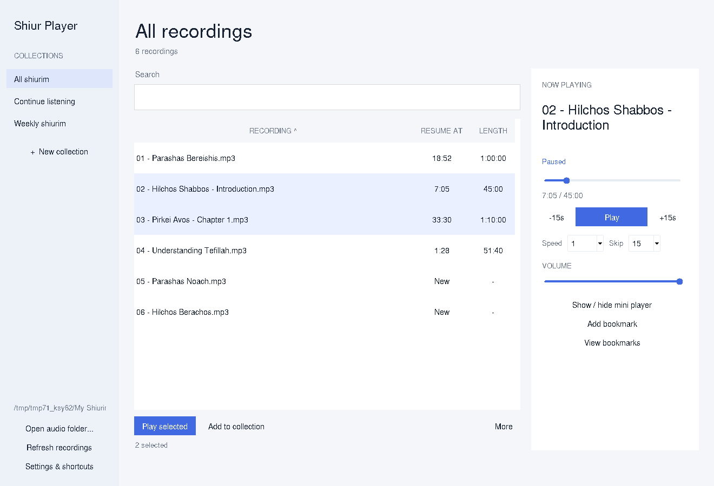

# Shiur Player — Standalone Windows App

An English-only local shiur player for Windows x64. The recording library and playback controls are in the desktop app. No Otzaria, plugin, account, pairing code or connection service is required.

## Download

**[Download the standalone Windows app — 0.4.0](https://raw.githubusercontent.com/dakulefsky/ShiurListener/main/downloads/shiur-player-windows-x64-0.4.0.zip)**

Extract the **entire ZIP**, run **Shiur Player.exe**, choose the folder containing your recordings, and press Play. Keep the runtime folders beside the executable. Python and the audio runtime are included; no separate runtime installation is needed.

After restarting the computer, open the same EXE and press Play. The chosen folder, last recording and individual listening positions are remembered. Nothing starts playing automatically. The first standalone profile is separate from the previous Inside/Sidekick profiles; those are left untouched.

## Features

- Recording list and search; user-created named collections, with no preset collections.
- Each recording shows its own saved resume time; Continue listening sorts unfinished shiurim by recency.
- Flat sliders and slim scrollbars, a searchable library and Now Playing panel.
- Select several recordings and add them to an existing or new collection together.
- Sort by name, resume time or duration; window size and sorting are remembered.
- Local bookmarks and selected-recording reset.
- Play/Pause, previous/next, seeking, volume, 0.75–2× speed and 10/15/60-second skips.
- A floating mini player opens automatically when minimized.
- Sleep timer, automatic next recording and opt-in Windows-wide shortcuts.
- English-only native desktop controls; no browser or WebView interface.

Minimizing keeps playback running. Closing the main window stops the app and saves progress. Run the EXE again to restore an already-running main window. Use **Rescan** after adding audio files. Recordings stay in their existing folders and are not modified, copied or deleted.

[Installation and source guide](standalone/README.md) · [Source ZIP](https://raw.githubusercontent.com/dakulefsky/ShiurListener/main/downloads/shiur-player-standalone-source-0.4.0.zip) · [Checksums](downloads/SHA256SUMS.txt)

## Verification and limits

Controller tests cover separate positions, collections, bookmarks and playback actions. Actual Tk window tests verify three independent resume times, recent ordering, searching, switching and reopening. Real VLC WAV/MP3 decoding passes on Linux with dummy output.

Packaging verifies runtime/license preservation, source correspondence, x64 PE structure, the GUI subsystem and bundled Tk dependencies. Actual Windows rendering, global shortcuts and physical speaker output remain untested here. This is an unsigned portable build.

The app exposes no browser control or URL-opening command. Its bundled Python interpreter is general purpose; it is not a device-level browser/Internet lockdown tool.

## Earlier Otzaria versions

These remain available as earlier projects, but are not required by the standalone app:

- [נגן שיעורים 1.4.4 plugin](https://raw.githubusercontent.com/dakulefsky/ShiurListener/main/downloads/shiur-player-1.4.4.otzplugin) · [Plugin guide](player/README.md)
- [Sidekick 1.1.0 companion ZIP](https://raw.githubusercontent.com/dakulefsky/ShiurListener/main/downloads/sidekick-windows-x64-1.1.0.zip) · [Companion guide](sidekick/README.md)
- [Hebrew Otzaria developer handoff](docs/OTZARIA_AUDIO_HANDOFF.he.md)
