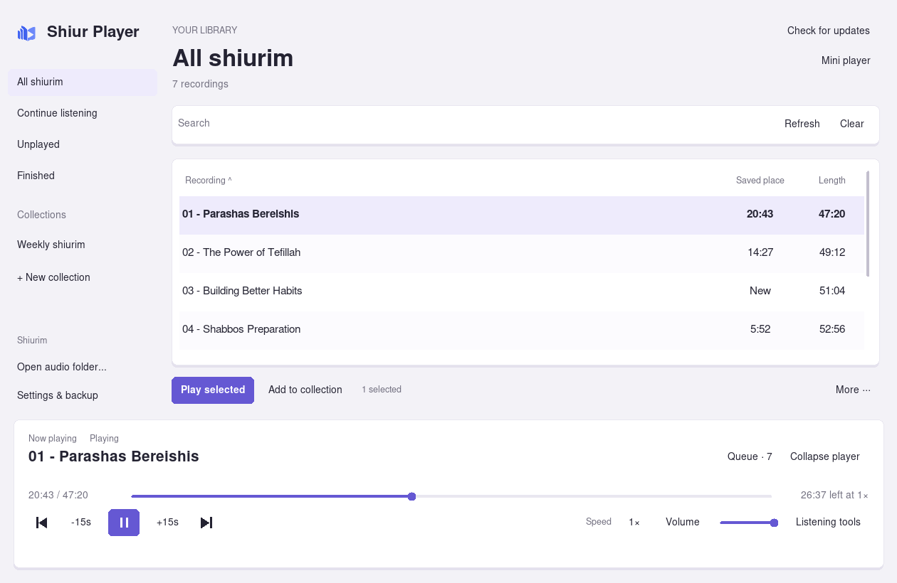

# Shiur Player — Standalone Windows App

An English-only local shiur player for Windows x64. The recording library and playback controls are in the desktop app. No Otzaria, plugin, account, pairing code or connection service is required.

## Download

**[Download the standalone Windows app — 0.9.4](https://raw.githubusercontent.com/dakulefsky/ShiurListener/main/downloads/shiur-player-setup-0.9.4.exe)**

Close the older player and run the **setup EXE once**. It creates desktop and Start menu shortcuts. Use **Check for updates** inside the app for future releases—no repeated manual extraction. Python and VLC are bundled. Existing standalone listening data stays in the same profile.

After restarting the computer, open the Shiur Player shortcut and press Play. The chosen folder, last recording and individual listening positions are remembered. Nothing starts playing automatically. The first standalone profile is separate from the previous Inside/Sidekick profiles; those are left untouched.

## Features

- Unplayed and Finished views; natural numbered sorting and multiword search.
- Editable queue with Play next, reordering and removal of upcoming recordings.
- A–B section repeat, jump to time and sleep presets including end of recording.
- Profile backup and restore with a safety copy.
- Full-width recording library and permanent playback dock.
- Recording list and search; user-created named collections, with no preset collections.
- Each recording shows its own saved resume time; Continue listening sorts unfinished shiurim by recency.
- Light styling with rounded controls, locked recording-list dividers and a clear Mini player button.
- Select several recordings and add them to an existing or new collection together.
- Sort by name, resume time or duration; window size and sorting are remembered.
- Local bookmarks, recording rename with preserved saved places, and selected-recording reset.
- Play/Pause, previous/next, seeking, volume, 0.5–2× speed and 10/15/60-second skips.
- A compact, resizable floating mini player opens automatically when minimized and remembers its size.
- Each recording remembers its own speed, including after restarting.
- Collapse the mini player into a tiny pill; hover to reveal skip controls.
- Both speed buttons cycle 1× → 1.5× → 2× → 0.5× → 1×.
- Sleep timer, automatic next recording and opt-in Windows-wide shortcuts.
- English-only native desktop controls; no browser or WebView interface.

Minimizing keeps playback running. Closing the main window stops the app and saves progress. Run the EXE again to restore an already-running main window. Use **Rescan** after adding audio files. Recordings stay in their existing folders. Rename changes the filename and preserves listening data; audio contents are not rewritten or deleted.

[Installation and source guide](standalone/README.md) · [Source ZIP](https://raw.githubusercontent.com/dakulefsky/ShiurListener/main/downloads/shiur-player-standalone-source-0.9.4.zip) · [Checksums](downloads/SHA256SUMS.txt)

See the [0.9.4 whole-app review](docs/STANDALONE_REVIEW_0.9.4.md) for fixes, test evidence and remaining limits.

## Verification and limits

Controller tests cover separate positions, collections, bookmarks and playback actions. Actual Tk window tests verify three independent resume times, recent ordering, searching, switching and reopening. Real VLC WAV/MP3 decoding passes on Linux with dummy output.

Packaging verifies runtime/license preservation, source correspondence, x64 PE structure, the GUI subsystem and bundled Tk dependencies. Actual Windows rendering, global shortcuts and physical speaker output remain untested here. This is an unsigned per-user installer. Installer extraction and version activation have been tested on Linux; actual Windows setup, shortcuts and restart remain unverified here.

The app exposes no browser control or URL-opening command. Its bundled Python interpreter is general purpose; it is not a device-level browser/Internet lockdown tool.

## Earlier Otzaria versions

These remain available as earlier projects, but are not required by the standalone app:

- [נגן שיעורים 1.4.5 plugin](https://raw.githubusercontent.com/dakulefsky/ShiurListener/main/downloads/shiur-player-1.4.5.otzplugin) · [Plugin guide](player/README.md)
- [Sidekick 1.1.0 companion ZIP](https://raw.githubusercontent.com/dakulefsky/ShiurListener/main/downloads/sidekick-windows-x64-1.1.0.zip) · [Companion guide](sidekick/README.md)
- [Hebrew Otzaria developer handoff](docs/OTZARIA_AUDIO_HANDOFF.he.md)
