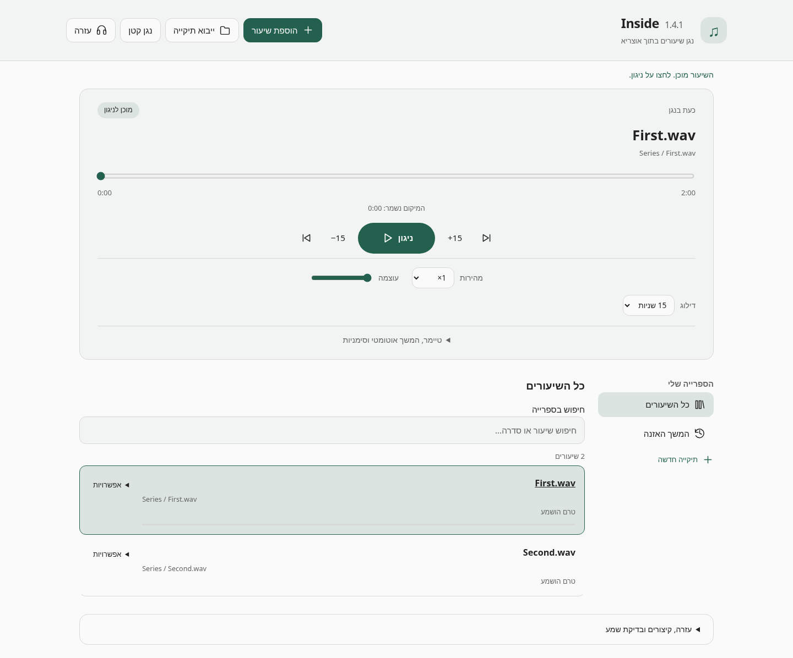
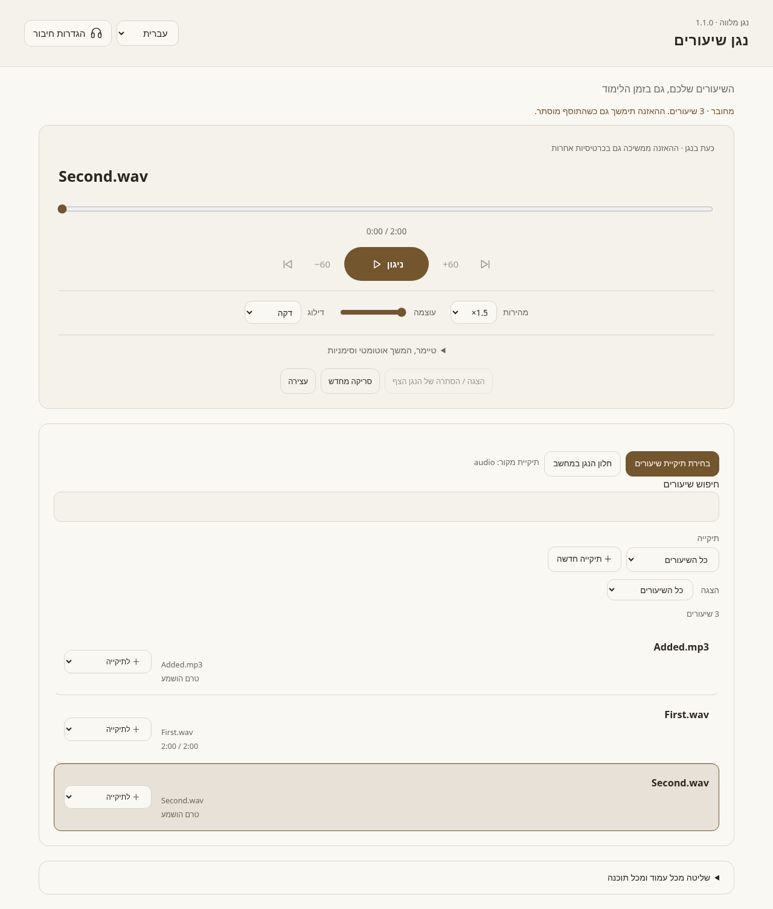

# ShiurListener — נגן שיעורים

A Hebrew local-shiur player for Otzaria 0.9.98 or newer.

## Download

- **[Inside 1.4.1 — plugin-only player](https://raw.githubusercontent.com/dakulefsky/ShiurListener/main/downloads/inside-1.4.1.otzplugin)** — redesigned controls, recovery actions, saved positions and a bundled sound check. Install directly in Otzaria; no companion is required.
- [נגן שיעורים / Shiur Player 1.1.0 — Windows companion ZIP](https://raw.githubusercontent.com/dakulefsky/ShiurListener/main/downloads/sidekick-windows-x64-1.1.0.zip) — redesigned connection and playback controls, a refreshed floating bar, bundled runtimes and its Otzaria plugin.
- [Plugin source and developer documents](https://raw.githubusercontent.com/dakulefsky/ShiurListener/main/downloads/inside-source-1.4.1.zip).
- [Checksums](downloads/SHA256SUMS.txt).

The old Hebrew message about sound being blocked “במופע הרקע” comes from the older background player, not Inside 1.4/1.4.1. Version 1.4.1 visibly labels the correct player; its audio engine is unchanged from 1.4.0. Install the update and fully restart Otzaria so an old page or background instance is not left running. Keep existing plugin data.

## Install the plugin-only player

1. Install **inside-1.4.1.otzplugin** as an update in Otzaria. Keep existing plugin data; do not uninstall first.
2. Fully quit Otzaria (including its tray instance if it stays running), reopen it, and open **Inside** from the plugin list. Confirm that the heading says **Inside 1.4.1**. Allow reading user-selected files.
3. Click **הוספת שיעור** or **ייבוא תיקייה**. Wait for **מוכן לניגון**, then press **ניגון**.
4. If there is a problem, use **ניסיון נוסף**, or open **עזרה** and click **השמעת צליל בדיקה**. The help panel includes a direct audio strip. Expanded error details include the player version.

The first new recording loads silently; selecting a recording does not automatically start sound. Existing folders, bookmarks and per-shiur positions are retained on update. The new layout puts playback controls first and moves less-used actions into menus.

For reading while listening, right-click the player tab, choose **הצג לצד**, then choose an open book. Keep the player pane visible. **נגן קטן** reduces the controls. Hiding the player or minimizing Otzaria may pause it.

## Instructions for Otzaria developers

[Hebrew handoff: playback across tabs, floating controls and global shortcuts](docs/OTZARIA_AUDIO_HANDOFF.he.md).

It includes a forwardable request, inspected host code paths, a proposed native audio API, permission boundaries, cross-platform floating-window requirements and acceptance tests. These are proposed host changes; the plugin does not claim to implement them by itself.

[Plugin source, installation details and verification](player/README.md). No Otzaria native source is modified by the 1.4.0 update.

## נגן שיעורים / Shiur Player — the companion (Sidekick)

[Download 1.1.0 for Windows](https://raw.githubusercontent.com/dakulefsky/ShiurListener/main/downloads/sidekick-windows-x64-1.1.0.zip). Close the older command-prompt companion first. Extract the entire ZIP, run **Sidekick.exe**, and use the normal app window to choose the folder containing your audio files. Its full path and recording count are shown. Click **Copy code**, install the included **sidekick-1.1.0.otzplugin** in Otzaria as an update, and connect in **נגן שיעורים**.

There is no command window to keep open. Once connected, both the plugin code form and native setup window hide automatically. Closing the native setup window with X also hides it while audio continues; **Exit player** actually stops the app. Reopen setup by running the EXE again, using **Open desktop app** in the plugin, or **Library / connection** on the floating bar.

Both interfaces offer **עברית / English**. The visible name is **נגן שיעורים** or **Shiur Player**; Sidekick remains our nickname and the EXE filename. Use **Choose recordings folder** to change the source and **Rescan folder** after adding files. The chosen folder and per-recording positions are retained. Recordings are not copied, changed or deleted.

[Setup and source](sidekick/README.md) · [Source ZIP](https://raw.githubusercontent.com/dakulefsky/ShiurListener/main/downloads/sidekick-source-1.1.0.zip)

Sidekick remains independent of Inside and has separate data. Update both parts from the same ZIP without uninstalling or clearing data. The Windows GUI launcher and native callbacks are checked structurally/with mocks; actual Windows desktop operation and speaker output remain unverified here.

## Verification and limitations

Version 1.4.0 passes eight persistence regressions, real-WAV Chromium tests with click restrictions enabled, and a test using Otzaria's actual JavaScript bridge with a file-origin page and separate loopback media server. Startup retry, preservation after failed library reads, old-WebView UUID compatibility and missing-recording recovery are covered. The actual Otzaria packager validates its manifest and design.

The supplied background-policy error was traced to the old 1.2 background player. Inside 1.4.1 clearly labels the visible-page player, and an additional WAV playback/resume test passed through Otzaria's actual Dart file server. The updated build has not been run in an installed Windows/macOS/Linux Otzaria application. Browser playback tests do not verify physical speaker output.

The companion Windows executable, floating bar and global shortcuts also remain unverified on a Windows computer. Its service and VLC decoding checks ran on Linux; VLC checks used a dummy audio output.

The plugin has no external network or browser-opening permission. The companion is not a device browser-lockdown tool: it bundles a general Python interpreter. Runtime licenses and source URLs are included in its ZIP.
