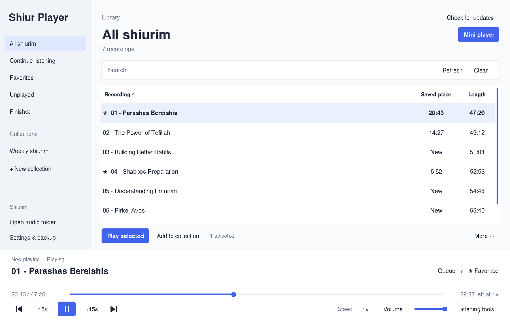

# Shiur Player 0.8.1

An English-only local Windows x64 desktop player with a light interface, rounded controls, blue accents and a dedicated Now Playing panel. The complete portable ZIP includes Python, Tk and VLC; users install none separately. No Otzaria, pairing code, browser or network service.

Close the old player and run **shiur-player-setup-0.8.1.exe** once. Setup installs per user under `%LOCALAPPDATA%\Programs\ShiurPlayer` and creates desktop/Start menu shortcuts, without elevation, PowerShell, browser UI or separate runtime installation. Open the installed shortcut on future days.

Click **Check for updates** in the app for subsequent releases. Checks run only when requested. The app fetches a small release JSON from this repository, validates its version/URL/size/SHA-256, downloads the installer in a worker thread, saves playback state and starts setup. Setup waits for the old player process to exit before selecting and starting the new version. Program files use separate version directories and an atomic `active.json` pointer, leaving the previous version selected if extraction/activation fails. User data and audio recordings are outside the installation tree. Previous program versions are retained; old portable copies are not removed.

Update downloads are restricted to this repository's versioned raw GitHub installer URLs. TLS and SHA-256 detect transport/content mismatch; this is not code signing. A portable ZIP remains available, with the same in-app update button. Updating a portable copy installs the stable shortcut-based version with the existing standalone profile.

Every recording has its own saved position, shown in the list. **Continue listening** shows unfinished recordings in recent listening order. Switching recordings, pausing and normal closing save progress, alongside periodic checkpoints. Sudden termination can lose the newest interval; seek precision depends on the file. Keep file paths unchanged. Existing standalone 0.1.0/0.2.0/0.3.0/0.4.0 positions are reused automatically.

Hold Ctrl/Shift to select several recordings, or Ctrl+A for the visible list. Add them to a collection in one operation. Column headings sort the list by name, resume position or duration. Right-click offers playback and collection actions. The app remembers window size and sort preference. Column dividers are locked, while clicking headings still sorts. Idle refreshes preserve existing rows and slider graphics rather than recreating them.

Create and name collections yourself. Select a recording, click **Add to collection**, choose an existing collection or type a new name, then **Add recording**. Creating and assigning a new collection happens in one action. Use More to rename/delete a collection, remove a member or reset only one recording. Collections do not copy or delete audio. Bookmarks, 0.5–2× speeds, 10/15/60-second skips, sleep timer, automatic next-track playback, optional global keyboard shortcuts and floating controls are included. Minimizing automatically shows the always-on-top mini player. Restore the main window to hide an automatically opened mini player; a manually opened one stays visible. A prominent **Mini player** button also shows/hides it. The floating window defaults to 360×150 instead of 410×224, has a resizable frame with a 300×140 minimum, and saves its size and position after dragging/resizing. Buttons rearrange with the client area. Its speed button cycles **1 → 1.5 → 2 → 0.5 → 1×** by default; Settings offers the **1 → 1.5 → 2 → 0.5 → 1×** alternative. The main speed selector follows changes made in the mini player. Disable automatic showing in Settings if preferred. Close to save and stop.

See [the instructions](READ%20ME%20FIRST.txt) for keyboard shortcuts. State stays at `%LOCALAPPDATA%\ShiurPlayerStandalone\state.json`; earlier Inside/Sidekick profiles remain separate.



## New in 0.8.0

The library uses the full window width above a permanent playback dock. Favorites, Unplayed and Finished join Continue listening. Numbered recordings sort naturally, and search matches all entered words. Right-click or More offers Play next, Add to queue and Favorite; the Queue window supports reordering and removing upcoming recordings. Current audio keeps playing during queue changes.

Listening tools adds A–B section repeat, jump to time, 15/30/45/60-minute sleep presets, and pause at the end of the recording. Repeat and end-of-recording timers exclude one another. The dock displays time remaining adjusted for playback speed. The native mini player has a clickable progress strip and elapsed/remaining time.

Settings & backup exports the listening profile as JSON and restores validated backups with a pre-restore safety copy. Audio stays external and the current library folder is preserved. Seeking or skipping a remembered recording before decoder loading keeps its requested position and stays paused; completed recordings replay from the start.

## Validation

Controller and actual Tk window tests verify three separate positions, switching, reopening, near-end progress, recent ordering, filtering, batch collection assignment, sorting, window-size restoration, focused-button Space behavior, custom sliders, collections and bookmarks. Idle GUI refresh tests assert no row movement, tag rewrites or canvas reconstruction. Win32 mocks verify resize messages, saved bounds, the speed button and unchanged captions staying untouched across ten timer ticks, alongside minimize/restore behavior. The previous twice-per-second full-window erase/invalidation was removed; paints now follow content/theme/size changes. Real libVLC WAV/MP3 decode, seek, pause/resume and next-track tests pass on Linux using dummy output. Packaging verifies source bytes, preserved existing runtime, Tk library layout, x64 PE headers and the GUI subsystem. Actual Windows rendering, global shortcuts and physical speaker output have not been tested here. This is an unsigned portable Windows build; Mac/Linux packages are not included.

The app has no browser control or URL-opening action. Its bundled interpreter is general purpose; this is not an OS-level browser lockdown.

## Build

```sh
DISPLAY=:99 python -m unittest discover -s standalone/tests -p 'test_*.py'
python standalone/tests/test_real_vlc.py
GOOS=windows GOARCH=amd64 CGO_ENABLED=0 go build -trimpath -ldflags='-s -w -H windowsgui' -o 'standalone/build/Shiur Player.exe' standalone/build/launcher.go
python standalone/build/package.py --base downloads/sidekick-windows-x64-1.1.0.zip --tk /path/to/extracted/tcltk
```

Window tests need a desktop display; real decoder tests need VLC and ffmpeg. Tk payload comes from the official Python 3.13.17 amd64 `tcltk.msi`, SHA256 `ae3e5f9dd998b36d14655cd3444d0af906c1849c60aee40994eeb1e460a3cabf`, extracted with msiextract. Ship `_tkinter.pyd` and its DLL dependencies, the tkinter package and Tcl/Tk script libraries, excluding IDLE, demos and tests. Source URLs and license notices are bundled.

## Installer build

Set the release in `app/version.py`, build the portable payload with `build/package.py`, then run:

```sh
python standalone/build/build_installer.py --go /path/to/go
GO111MODULE=off go test ./standalone/build/installer
```

The builder cross-compiles the stable installed launcher and self-contained setup as Windows GUI x64 binaries, embeds the full ZIP, and writes `downloads/standalone-latest.json` with size and SHA-256. Publish the new setup and channel JSON together. No store credentials or automatic publishing are involved. The installer core tests actual extraction, sequential version activation, path rejection and preservation of the separate state file. Network tests reject changed checksums, foreign origins and downgrade offers. Actual Windows COM shortcuts, native setup and update restart have not been executed here.

## 0.8.0 corrections

Simpler branding, a light library and playback dock, rounded keyboard-operable controls, vector playback icons, a custom speed menu, fewer borders, unstriped rows and filename extensions hidden in the list. Mini speed defaults to 1 → 1.5 → 2 → 0.5 → 1×. Existing installations receive this corrected cycle once on upgrade; Both players use the same fixed order. Listening positions are preserved.

## 0.8.1 speed cycle
Both main and mini speed buttons use 1 → 1.5 → 2 → 0.5 → 1×, regardless of older cycle preferences. Right-click the main speed button for individual rates.
