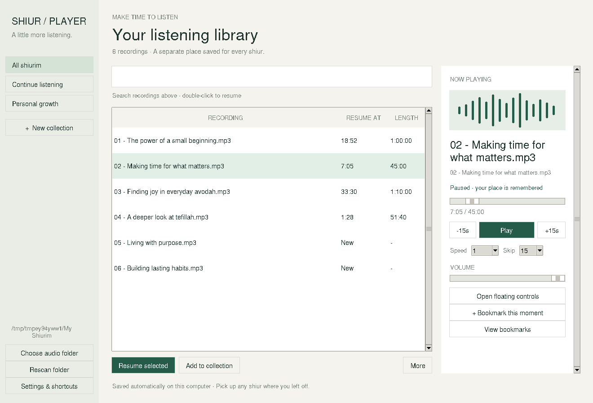

# Shiur Player 0.2.0

An English-only local Windows x64 desktop player with a redesigned library, collection sidebar and dedicated Now Playing panel. The complete portable ZIP includes Python, Tk and VLC; users install none separately. No Otzaria, pairing code, browser or network service.

Extract the entire ZIP and open **Shiur Player.exe**. Choose an audio folder once. Double-click a recording or click **Resume selected**. On another day, open the app and press Play.

Every recording has its own saved position, shown in the list. **Continue listening** shows unfinished recordings in recent listening order. Switching recordings, pausing and normal closing save progress, alongside periodic checkpoints. Sudden termination can lose the newest interval; seek precision depends on the file. Keep file paths unchanged. Existing standalone 0.1.0 positions are reused automatically.

Create and name collections yourself. Use Add to collection, or More to rename/delete a collection, remove a member or reset only one recording. Collections do not copy or delete audio. Bookmarks, 0.75–2× speeds, 10/15/60-second skips, sleep timer, automatic next-track playback, optional global keyboard shortcuts and floating controls are included. Minimize to keep playing; close to save and stop.

See [the instructions](READ%20ME%20FIRST.txt) for keyboard shortcuts. State stays at `%LOCALAPPDATA%\ShiurPlayerStandalone\state.json`; earlier Inside/Sidekick profiles remain separate.



## Validation

Controller and actual Tk window tests verify three separate positions, switching, reopening, near-end progress, recent ordering, filtering, collections and bookmarks. Real libVLC WAV/MP3 decode, seek, pause/resume and next-track tests pass on Linux using dummy output. Packaging verifies source bytes, preserved existing runtime, Tk library layout, x64 PE headers and the GUI subsystem. Actual Windows rendering, global shortcuts and physical speaker output have not been tested here. This is an unsigned portable Windows build; Mac/Linux packages are not included.

The app has no browser control or URL-opening action. Its bundled interpreter is general purpose; this is not an OS-level browser lockdown.

## Build

```sh
DISPLAY=:99 python -m unittest discover -s standalone/tests -p 'test_*.py'
python standalone/tests/test_real_vlc.py
GOOS=windows GOARCH=amd64 CGO_ENABLED=0 go build -trimpath -ldflags='-s -w -H windowsgui' -o 'standalone/build/Shiur Player.exe' standalone/build/launcher.go
python standalone/build/package.py --base downloads/sidekick-windows-x64-1.1.0.zip --tk /path/to/extracted/tcltk
```

Window tests need a desktop display; real decoder tests need VLC and ffmpeg. Tk payload comes from the official Python 3.13.17 amd64 `tcltk.msi`, SHA256 `ae3e5f9dd998b36d14655cd3444d0af906c1849c60aee40994eeb1e460a3cabf`, extracted with msiextract. Ship `_tkinter.pyd` and its DLL dependencies, the tkinter package and Tcl/Tk script libraries, excluding IDLE, demos and tests. Source URLs and license notices are bundled.
